# RustyBar for Windows

A status bar at the top of every screen, for a gaming PC: it must cost no frames, and no CPU, GPU
or memory you could measure. The sibling of [RustyBar for macOS](https://github.com/Francesco-Rapetti/rustybar):
the same ideas, built on Windows' own pieces.

- **One small native process.** Rust on Win32, no webview, no .NET, no framework that redraws
  every frame.
- **Asleep when nothing changes.** Data comes from Windows' events (the app in front, the
  registry, the shell). What has no events (CPU, GPU, memory) is read in-process on a slow timer,
  every 5 seconds, and drawn only when a number changes; the clock wakes once a minute. Both
  stop while no bar shows.
- **Drawn only when something changes, animated by the compositor.** Pills are DirectComposition
  surfaces drawn with Direct2D on WARP, Windows' software rasterizer, on the bar's own thread: no
  GPU device at all, and no thread pool to wake up. Slides run inside DWM, so the bar does no
  work during an animation.
- **Popups that exist only while open.** A click on a pill opens its popup under it, as the
  taskbar's flyouts do: a window made when it opens and destroyed when it closes, with a click
  anywhere else, Esc or the pill again. A click on the bar itself never takes the focus from the
  app in front.
- **Out of the way of games.** A full screen app (exclusive or borderless) hides the bar of its
  screen; with every bar hidden, the bar lets go of its devices and sleeps until the game leaves.
  Listed games turn animations off even in a window.


## What it costs

Measured with `scripts\measure.ps1` on Windows 11 (5120×1440 and 1920×1080 screens; workspaces,
front_app, media, network, audio, system and clock):

| | at rest |
|---|---|
| Memory | 5–6 MB private working set |
| CPU | 16–47 ms in 60 s (system's readings, every 5 s, drawn on each screen) |
| Wake-ups | ~2.5–6 context switches/s (the most while a game keeps the GPU's numbers moving) |
| Threads | 2–5 |
| GPU | none: 0% engines, 0 MB of video memory |
| Child processes | 0 (claude, if you add it: one for under a second every 5 minutes) |
| First frame | ~55 ms after start |
| Binary | ~3.3 MB with Lua and the settings window, no runtime to install |

Core Audio costs ~0.3 MB and the media sessions ~0.8 MB; both say when something changes, so
neither wakes the bar on its own.

With a GPU device instead of WARP (`RUSTYBAR_GPU=hardware`) the bar takes 37 MB, 9.5 MB of video
memory and 24 threads: that's why it draws in software.

A reading of system costs ~0.7 ms, about 0.3 ms of it in the GPU driver (for the 3D engine; all
the engines, as Task Manager reads them, would be 4 ms on a Radeon). An open popup adds
0.3–2 MB; system's reads the processes every 2 seconds while open, ~6 ms each. When a popup is
gone the bar lets go of what drawing it left cached and gives the freed pages back to Windows:
after 50 popups the bar is back where it started.

The settings window is a process of its own that runs only while it's open (see Settings): with
it open, ~8 MB, no CPU and no wake-ups at rest, ~5 ms of CPU for a change; the bar carries none
of it. A change reloads only the widgets whose options changed: a click in the window doesn't run
`claude` again or reconnect to Home Assistant.

## Build and install

Rust with the MSVC toolchain:

```
cargo build --release
target\release\rustybar.exe install
```

`rustybar install`, for your user alone and without administrator rights:

- copies the executable to `%LOCALAPPDATA%\Programs\RustyBar` (closing the installed bar first,
  so the same command updates it);
- writes the example config to `%APPDATA%\rustybar\rustybar.toml`, if there's none;
- starts the bar with Windows (the `Run` key: Settings > Apps > Startup shows it, with its
  switch);
- lists it in Settings > Apps, whose *Uninstall* runs `rustybar uninstall`;
- adds a *RustyBar* shortcut to the Start menu, and a *RustyBar Settings* one for the settings
  window, and starts the bar.

`rustybar uninstall` undoes all of it and leaves the config and the logs. Both do their work in
a second run started by File Explorer, as the bar is at sign-in: from the terminal of an app
package (the Claude app's, for one) Windows would keep the registry, and maybe the config, private
to that app, and the bar wouldn't start with Windows. Other commands:

- `rustybar quit` closes the running bar (of the same config dir); the Start menu shortcut
  starts it again.
- `rustybar check` checks the config: that it parses, the theme exists and every name in
  `[layout]` is a widget, with the one most likely meant for a name that isn't (`sistem`:
  `system`; the Layout page of the settings has a «→ system» to take it).
- `rustybar settings [page]` opens the settings window (see Settings), on a page: `bar`, `theme`,
  `layout`, `about`, or a widget by its name in `[layout]` (`rustybar settings clock`).
- `rustybar msg <command>` talks to the running bar, for scripts and keyboard shortcuts (bind
  `rustybar msg popup clock` to a key with PowerToys, for one):

  ```
  rustybar msg ping              pong, if the bar runs
  rustybar msg reload            read the config again, every widget anew
  rustybar msg query             the widgets, where their pills are on each screen
  rustybar msg popup <widget>    open its popup on the screen with the mouse, or close it
  rustybar msg shot <what> <file.png> [scale]
                                 draw a popup, or the pills, into a PNG (see Made-up data)
  rustybar msg trigger <name> [key=value…]
                                 an event for the Lua widgets that listen to it
  rustybar msg quit              close the bar
  ```

  A command is a window message to the bar (`WM_COPYDATA`), so the bar listens on nothing and
  costs nothing while no command comes. In PowerShell, which doesn't wait for a windowed program,
  add `| Out-Host` to see the answer before the next prompt.
- The log is `%LOCALAPPDATA%\rustybar\rustybar.log`. If the bar ever fails, the log says why
  (the message and the line of a panic, or the code of a fault), and the bar starts again by
  itself: at most 3 times in 10 minutes, so one that fails at every start doesn't loop.

For trying `media` without real music, `cargo run --release --example fake_player -- [0|1]
[seconds]` is a made-up player: a media session with made-up tracks and covers drawn on the
spot, a silent sound for the volume mixer, and working controls; it ends by itself (after 120 s).
A copy of its executable under another name (`Aurora.exe`) is another app.

## Configuration

`%APPDATA%\rustybar\rustybar.toml`, reloaded when you save it. Every key has a default, so the
file is optional; [`config/rustybar.toml`](config/rustybar.toml) lists them all.

What you'd rather keep out of a shared dotfiles repo, such as a server or your accounts, can go
in `rustybar.local.toml` next to it: its tables are merged over those of `rustybar.toml`, key by
key, and any other value (a list too) replaces the one there.

Environment variables:

- `RUSTYBAR_CONFIG_DIR`: another config dir. A bar with its own dir runs next to the real one,
  with its own log (`rustybar-<dir name>.log`); with `[bar] reserve = false` it doesn't move the
  windows.
- `RUSTYBAR_GPU=hardware`: draw with the GPU instead of WARP (see above).
- `RUSTYBAR_LOCALE`: another language and region for the texts, dates and numbers (`en-US`,
  `it-IT`), instead of Windows'.
- `RUSTYBAR_MOCK`: made-up data (see below).

### When the bar doesn't fit

On a narrow screen the pills give way instead of running into each other: first the center
group turns compact; then the widgets farthest from their edge switch, one at a time, to their
compact form (the clock without the date, `system` with the memory alone, `network` and `audio`
as icons, `media` with the title alone, `claude` with the session alone, `front_app` cut
shorter); when every one is compact they move, one at a time, into the popup of a `⋯` pill at
the inner end of their side, where a click on one opens its popup as its pill would. A side
takes its bigger forms back only with some room to spare, so a widget whose width changes
doesn't flip at the limit. Each screen fits on its own; where everything fits, as on a wide
screen, it costs a sum and nothing more is measured. `rustybar msg query` says what's compact
and what's in `⋯`, and `rustybar msg popup ⋯left` (or `⋯right`) opens that popup.

With room to spare, the center group may take more of it instead: `media`'s title and artist
are cut later, and go back to their own form as soon as the room is gone. `[bar]
always_compact = ["system"]` keeps widgets in their compact form on every screen, and `[bar]
screens = "primary"` puts a bar on the main screen alone (by default every screen has one).

## Settings

The settings window edits the config for you, in the style of Windows 11's Settings: open it
from the Windows menu of the bar (*RustyBar settings…*), from the Start menu (*RustyBar
Settings*) or with `rustybar settings [page]`.

<p align="center">
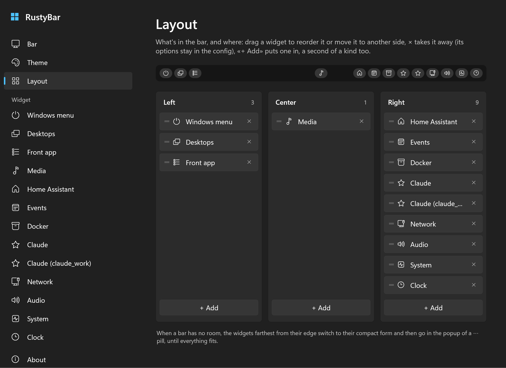
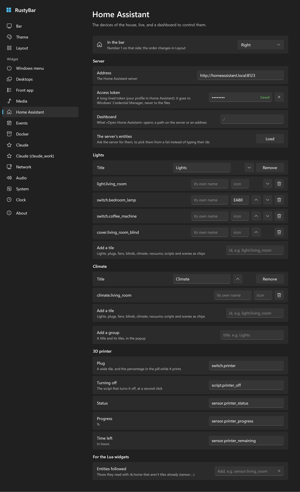
</p>

- **Bar**: height, margin, reserving the space, the popups' gap, the screens with a bar, the widgets
  always compact; the games (`[games] apps`).
- **Theme**: the palette with its colors, the accent, the font (the families installed in
  Windows), the sizes of the pills and popups, animations, and the palette colors you override.
- **Layout**: the three sides of the bar as columns of chips: drag one to reorder it or move it
  to another side, × takes it away (its options stay in the config), *+ Add* puts in a widget
  that isn't there, another of a kind (a second clock, another Claude account) or one of your
  Lua widgets. A click on a chip opens its page.
- **A page for each widget**: where it sits, and its options. The secrets (Home Assistant's
  token, the calendars' secret addresses) go to Windows' Credential Manager from a hidden field,
  never to the files. A Lua widget has a control for each key it has in the config, by the
  type of its value, and *Add an option*. Home Assistant's page has the groups with ↑ ↓, each tile
  on a row with its own name and icon, ↑ ↓ and the bin, and the server's entities to pick from a
  menu instead of typing their ids (*Load* asks the server for them, from the settings window:
  the bar asks nothing more), and the entities the Lua widgets follow.
- **About**: the version, the folders, the files to open, and what `rustybar check` finds wrong.

Every change is written at once, in place: comments and order stay, each key stays in the file
it's in (`rustybar.local.toml` or `rustybar.toml`), a value set back to its default goes away, and
a file that doesn't parse is shown and left alone until it's fixed. The bar sees the file change
and reloads by itself, only what changed: a widget whose options are the same keeps running.

The window runs in a process of its own that ends when you close it, so the bar carries none of
it (see What it costs). It draws as the popups do, with Direct2D on DirectComposition and WARP,
and only what changed; scrolling moves the page, which the compositor animates. The text fields
are Windows' own while you type in them (IME, clipboard, undo); the rest is drawn, without
screen-reader support.

## Widgets

Each popup, on made-up data (see [Made-up data](#made-up-data)):

<table>
<tr>
<td align="center" valign="top">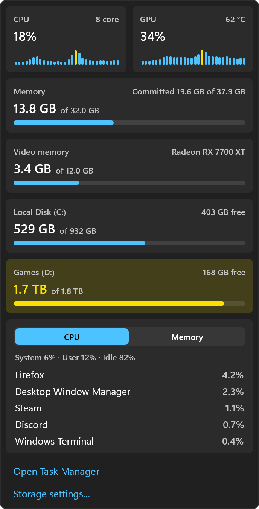<br><code>system</code></td>
<td align="center" valign="top">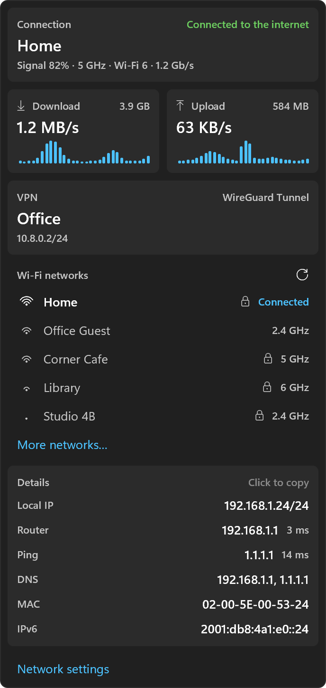<br><code>network</code></td>
</tr>
<tr>
<td align="center" valign="top">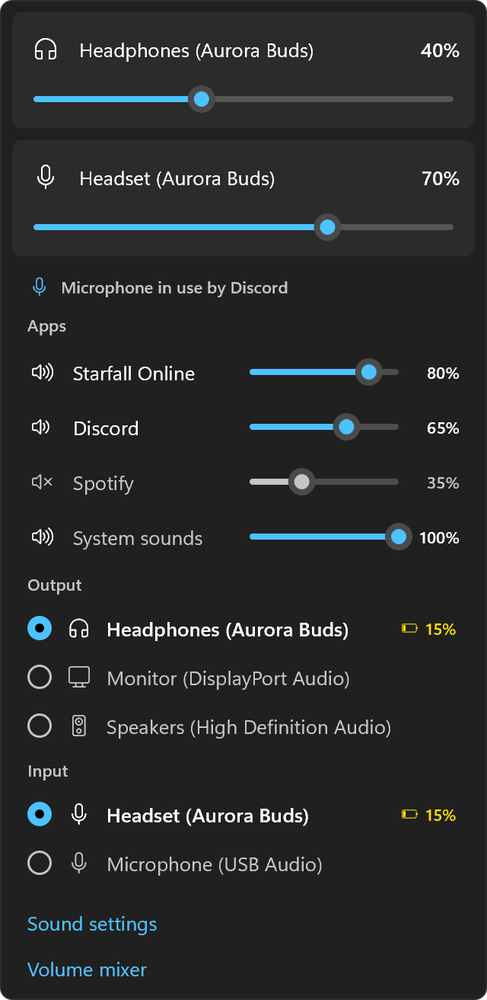<br><code>audio</code></td>
<td align="center" valign="top">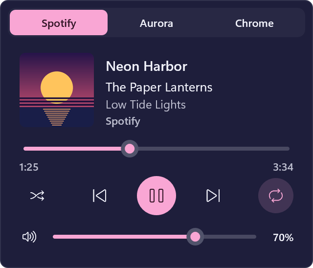<br><code>media</code><br><br>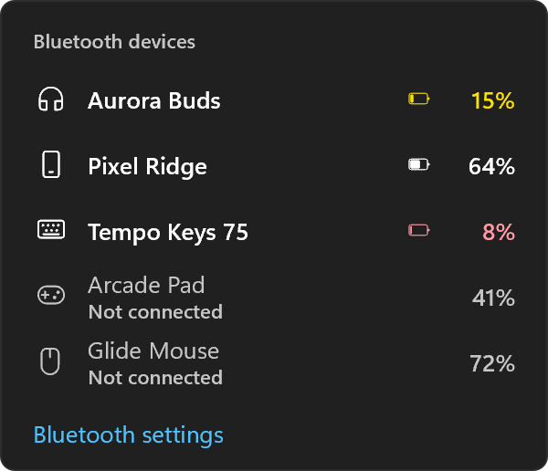<br><code>devices</code></td>
</tr>
<tr>
<td align="center" valign="top">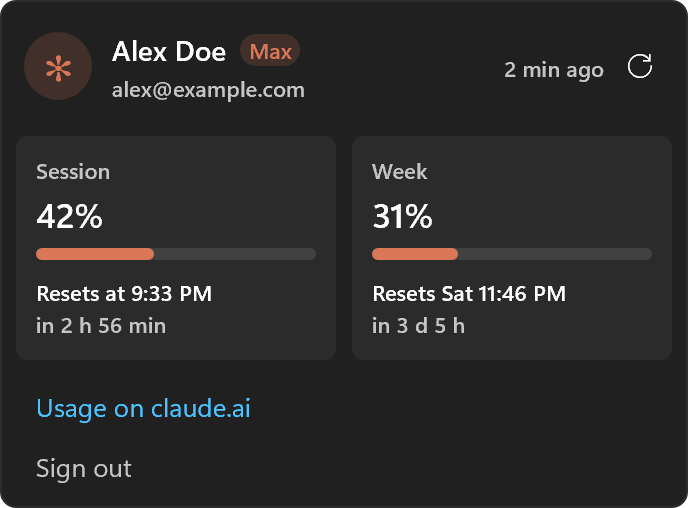<br><code>claude</code></td>
<td align="center" valign="top">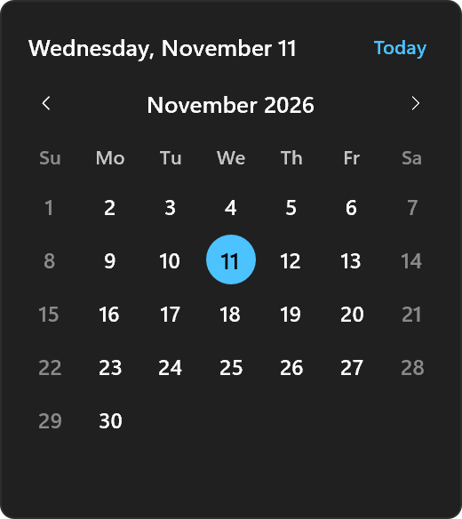<br><code>clock</code><br><br>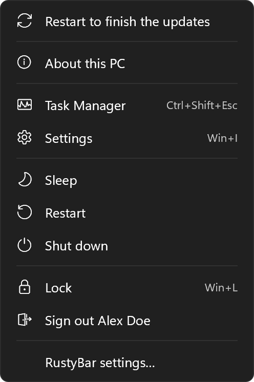<br><code>power</code></td>
</tr>
<tr>
<td align="center" valign="top">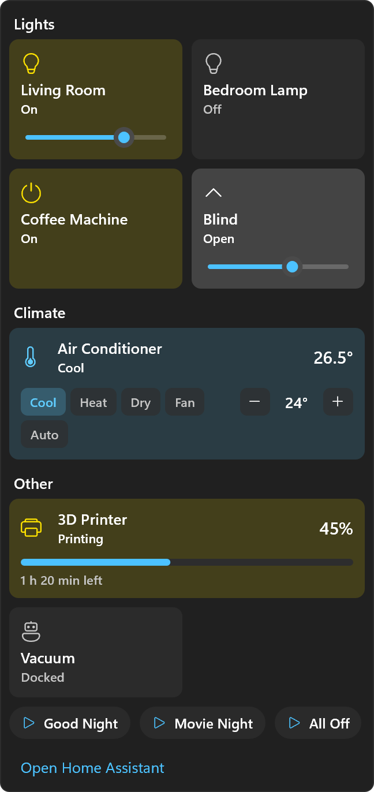<br><code>home</code></td>
<td align="center" valign="top">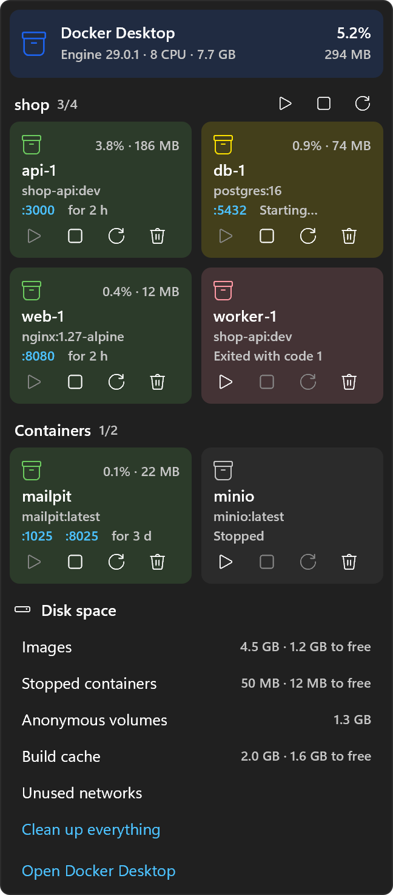<br><code>docker</code></td>
</tr>
<tr>
<td align="center" valign="top">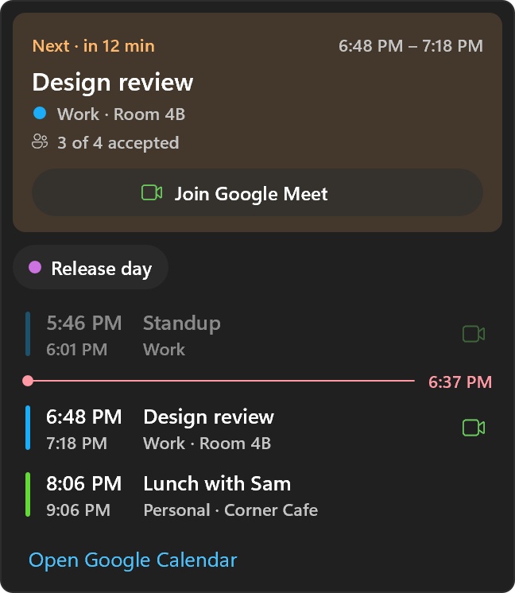<br><code>events</code></td>
<td align="center" valign="top">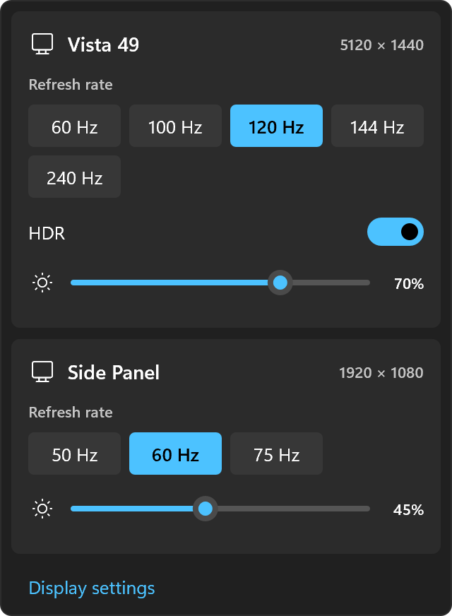<br><code>display</code></td>
</tr>
</table>

- **clock**: the date and time in the formats of Windows (`Mar 10/11  21:13`). Its popup is a
  calendar, a month at a time: today in a dot, the week from the region's first day, the weekend
  dimmer; ‹ ›, the wheel and the arrow keys go through the months, *Today* (or Home) back. A
  click on a day opens it in Google Calendar. Options: `date`, a Windows date picture, `""` for
  the time alone; `open`, the page a click on a day opens, with `{year}`, `{month}` and `{day}`
  in it, `""` for days that can't be clicked; `timezone`, for a clock of another place, by its
  IANA name (`Asia/Tokyo`, `UTC`) or Windows' (`Tokyo Standard Time`), with daylight saving time
  as Windows has it.
- **power**: the Windows logo, alone on the desktop with no pill around it, as the macOS RustyBar
  has Apple's (its four squares are drawn: no font has it). Its popup is the menu of Start's
  power button and of Win+X:
  About this PC, Task Manager, Settings, Sleep, Restart, Shut down, Lock, Sign out (with your
  name), and RustyBar's settings. Restart, Shut down and Sign out take a second click, so a slip
  of the mouse doesn't end a game; they work as Start's do (fast startup, apps back after
  sign-in, as Windows is set). While Windows Update waits for a restart, a dot by the logo (as on
  Start's power button) and a first row, *Restart to finish the updates*, that opens Windows
  Update. It costs nothing at rest: no timer, and only the registry key of Windows Update watched
  for a subkey that comes or goes (`RebootRequired`).
- **front_app**: the name of the app in front, from its executable's version information
  (`Google Chrome`), cut at 260 DIPs. The taskbar and the desktop leave it as it was.
- **workspaces**: the virtual desktops, the current one under a highlight that slides; a click
  on one goes there, with Windows' own Ctrl+Win+←/→ (simulated, so not while a listed game is in
  front). Hidden with a single desktop (`single = true` keeps it).
- **audio**: a part for the output and one for the input, as on macOS, each with its icon, its
  device's name and its volume, and its background filled up to the volume in the primary color
  (gray when muted). The output's icon goes by its kind (headphones, a display, speakers by how
  loud; crossed out when muted), with the battery of a Bluetooth output after it; the input's is
  the microphone, crossed out in red while muted and lit while an app uses it (with a camera
  while one uses that), as the taskbar's privacy icon. A headset, one device for both, has one
  name. Windows calls devices `Headphones (Aurora Buds)`: the pill says `Aurora Buds`, or what it
  is when the brackets hold the sound card (`Speakers (Realtek(R) Audio)` says `Speakers`);
  `names` gives your own. Compact: the icons, with the fills. Its popup: the volume of the
  output and of the input, with a slider (click or drag) and mute on the icon; which apps use
  the microphone and the camera; the mixer, every app with sound on the output (a game, a chat,
  a browser) with its slider and mute; the devices to
  switch to (the one in use lit); the sound settings and the volume mixer. Core Audio tells
  every change, so nothing is read on a timer, except the battery of a Bluetooth device in use
  (Windows doesn't announce it): every 5 minutes. A click on a device makes it the default
  through `IPolicyConfig`, the undocumented interface Windows' own sound settings use. Which
  apps use the microphone or the camera comes from the registry Windows keeps for its privacy
  icon, watched for changes, so it wakes the bar only when an app opens or closes one; the mixer
  exists only while the popup is open. The fills are drawn with the text, only when a volume
  changes. Options: `input = false` (the output alone), `names = { "Headphones (Aurora Buds)" =
  "Buds" }` (by the full name the popup shows, or by the pill's), `privacy = false` (no
  microphone or camera in use), `mixer = false`.
- **media**: what's playing in any app with a player (`♪ Title  Artist`), from the media
  sessions Windows keeps (the ones of the volume flyout); dimmed with a pause sign while paused
  (`paused = false` hides it), hidden when nothing plays. In the center group, with room to
  spare, the title and the artist take more of it before they're cut. Its popup is a player: the cover, the
  title, the artist, the album and the app, where the track is (click or drag to seek), shuffle, ⏮ ⏯ ⏭ and
  repeat (shuffle and repeat for the apps that take them), and the app's own volume as the volume
  mixer has it (not for an app whose session has no readable id, such as Firefox). With more
  than one app playing, a switch at the top picks the one the player is for. The popup takes its
  colors from the cover, as Android's player does (`cover_colors = false` keeps the theme's).
  All on events; the position moves once a second only while the popup is open and the track
  plays. The cover, its colors (~3 ms on a worker thread), the list of apps and the app's audio
  sessions (~5 ms) are read only for the open popup (`cover = false` leaves the cover out).
  `pill_cover = true` puts the cover in the pill too, in place of ♪: off by default, as it's
  decoded at every track (a few ms on a worker thread) and keeps WIC loaded (~0.2 MB of the
  bar's own memory, ~3.7 MB shared).
- **claude** (not in the default layout: it costs a process): how much of the Claude plan's
  limits the account has used, `✻ 42% · 31% · 17:07` (the 5-hour session, the week, when the
  session starts again), yellow from 75%, red from 90%. Its popup: the account, the session and
  the week with when they reset, the usage page, sign out; logged out, *Sign in* (opens the
  browser). The numbers come from Claude Code itself (`claude -p` answering the `get_usage`
  request, without sending a message), found on the PATH or carried by the Claude desktop app;
  its CLI needs its own login, done once with *Sign in*. **Cost:** the only child process of the
  bar, every 5 minutes while a bar shows and no listed game is in front: ~0.4 s of CPU and
  ~190 MB for under half a second, at idle priority with EcoQoS, ended with the bar. Logged out
  it runs only when the popup opens. Options: `dir` (another Claude Code config dir, for a
  second account as a second widget with `type = "claude"`), `color`, `path`, `warning`,
  `critical`.
- **network**: the connection's icon and name (`Ethernet`, the Wi-Fi network), yellow with *No
  internet* when only the local network answers, red with *Disconnected* without one, `VPN` in
  front while a VPN is up. Its popup: the connection (adapter, link speed; signal, band and
  Wi-Fi generation), download and upload with the last 30 seconds as bars, the VPN, the nearby
  Wi-Fi networks to join (a secured new one opens Windows' own list, which asks the password),
  and the details (local IP, router with its ping, DNS, MAC, IPv6; a click copies one). Windows
  tells every change, so nothing is read at rest; the counters (every second) and the ping
  (every 5 seconds, in-process) run only while the popup is open. Since Windows 11 24H2 the
  Wi-Fi network's name and the list need the location permission for desktop apps. With
  `ping = "1.1.1.1"` (or a name, as a game's server) the details have a ping to that host too,
  while the popup is open: off by default, as otherwise the widget asks nothing outside your
  network.
- **system**: CPU, GPU (its 3D engines, and its temperature when the driver tells it) and memory
  (`CPU 12%  GPU 34% 62°  RAM 43%`), yellow from 75%, red from 90%; the temperature yellow from
  `temp_warning` and red from `temp_critical` (°C: by default 10° under the one the driver calls
  high and that one, or 85 and 95 when it doesn't say). Read every 5 seconds from
  Windows itself (no WMI, no performance counters); not at all while a listed game is in front.
  Its popup: CPU and GPU with the last 30 readings as bars (the GPU with its temperature, fan and
  clock), memory and video memory (with its clock), every fixed
  disk (a click opens it), the five apps that use the most CPU or memory, Task Manager and the
  storage settings. Options: `interval`, `warning`, `critical`, `disk_warning`, `disk_critical`,
  `temp_warning`, `temp_critical`, `gpu = false`. The fan and the memory's clock come with the
  temperature, in the same call; the GPU's clock costs ~0.3 ms in the driver, so only while the
  popup is open.
- **home** (not in the default layout: it needs a server): Home Assistant. A house in its blue
  with how many devices of the popup are on, gray while the server can't be reached; while a 3D
  printer prints, its progress in front. The popup is a dashboard of the `groups` of the config:
  lights (a click toggles, a slider dims), switches, fans, covers (a slider sets the position), a
  climate (its mode, the room's temperature, the modes, − target +), a vacuum, the printer's plug
  with the progress (off only at a second click), scripts and scenes as chips; *Open Home
  Assistant* last. It keeps one WebSocket open while a bar shows, subscribed to the entities of
  its tiles only: Home Assistant says what changed, the bar does nothing in between, and WinHTTP
  keeps the connection alive on its own threads. Closed while no bar shows (a game full screen).
  The token, a long-lived access token from your Home Assistant profile, goes in Windows'
  Credential Manager: `Get-Clipboard | rustybar secret set home-assistant`.

- **events** (not in the default layout: it needs your calendars): today's next event, from
  calendars in iCal format at their secret addresses (Google Calendar: the calendar's settings,
  *Secret address in iCal format*): its start time, yellow from 30 minutes, peach from 15, red
  from 5, the accent while it's on, then the title with a countdown, or *until* while it's on;
  the all-day ones when no timed one is left. The popup: the next event (calendar, place, guests,
  *Join Google Meet*), the all-day ones, today's timed ones with a line at the time it is now; a
  click joins the call or shows the day in Google Calendar. The calendars are downloaded on a
  worker thread every 15 minutes (`interval`), at start, on wake and at midnight, never while no
  bar shows or a listed game is in front; repeating events, exceptions and time zones are read
  as Windows has them. Each calendar is `{ name, color }` in `calendars`, and its address a secret:
  `Get-Clipboard | rustybar secret set events-<name>` (or `url` for a public one). Options:
  `soon`, `sooner`, `imminent` (minutes), `interval`, `open`.

- **docker** (not in the default layout): the containers of Docker Desktop, from the Engine API on
  its named pipe, with no `docker` CLI. A box in Docker's blue with how many run, gray when none,
  red when one fails its health check or keeps restarting; hidden while Docker isn't running. The
  popup: the engine with the CPU and memory of all the containers; the containers by Compose
  project (▶ ■ ↻ for the whole project), each with its state, CPU and memory, image, ports (links
  to `http://localhost:<port>`), how long it's been up, and ▶ ■ ↻ and remove (at a second click);
  the disk space of images, stopped containers, anonymous volumes and build cache, each cleaned
  up at a second click, unused networks and *Clean up everything*; *Open Docker Desktop*. It
  follows Docker's events on the pipe (a thread waiting on it, idle while nothing happens) and
  reads again a second after a burst of them; CPU and memory only while the popup is open. While
  Docker is off it tries the pipe every 30 s, not while no bar shows or a listed game is in front.
- **devices** (not in the default layout): the batteries of the mice, keyboards and controllers,
  behind a receiver or a cable too, and of the Bluetooth devices as Settings > Bluetooth & devices
  shows them (a phone, earbuds). The pill shows the connected ones that run low (`low`, 20%), the
  kinds of `pinned` always (`pinned = ["mouse", "keyboard", "controller"]`, one each), or every
  connected one with `always = true`, side by side with a thin line between them: its kind, a
  short name (the model without its maker: *Naga*, *Falcata*, *MX Master 4*; or yours, `names =
  { "Razer Naga V2 Pro" = "Desk" }`), its level as a small bar and a number, colored by how full
  it is (green above half, yellow down to a quarter, orange down to a tenth, then red; the number
  takes the color from yellow down), and a bolt while it charges. One behind a receiver that sleeps (a keyboard left
  alone, a mouse that's off) stays there dimmed, with the level it had when it last answered
  since the bar started. The popup has a tile for each connected one: its kind in a round badge,
  its full name, the maker, how it's connected and whether it charges (or when it last answered),
  the level big and as a bar (one for each half of a split keyboard), the tile tinted when it
  runs low; then the others in short rows, and the Bluetooth settings. A device seen on two links
  (paired over Bluetooth, on its receiver now) shows once.

  Besides Bluetooth, each maker's own way, all of it questions the device answers and never a
  setting: Razer (cable and HyperSpeed receivers), Logitech (HID++ through Bolt, Unifying and
  Lightspeed receivers; the receiver knows the name of a mouse that sleeps), ASUS ROG (SpeedNova
  and Omni receivers, both halves of a split keyboard), the Steam Controller (2026), DualSense and
  DualShock 4, Xbox controllers through XInput (four levels, not a percentage). Not a Keychron
  behind its receiver: nothing documents how to ask it (over Bluetooth it shows). `receivers =
  false` keeps Bluetooth alone.

  Windows doesn't announce a new level, so everything is read again every 5 minutes while a bar
  shows without a listed game in front, when the popup opens, and a second after Windows says a
  device came or went. Bluetooth on the main thread (well under a millisecond; ~10 ms for all of
  it); the receivers and cables on a worker thread that ends with the pass, with `hid.dll` loaded
  only for it: ~3.5 ms of CPU, up to 4 s of waiting while a Steam Controller sends its battery
  among its other reports. Finding the receivers again (~0.2 s on that thread) happens only when
  devices change.
- **display** (not in the default layout): the main screen's refresh rate (`120 Hz`), and `HDR`
  while it's on. Its popup has each screen with its name and resolution, the refresh rates it
  has at that resolution (a click switches, as Settings does), HDR on and off, and the
  brightness of a monitor that takes it over DDC/CI (set when the slider is let go). The
  configuration is read at the start and when Windows says the screens changed; the rates and
  the brightness only when the popup opens, the brightness on a worker thread (~60 ms a monitor
  over its cable; `brightness = false` leaves it out). Nothing runs at rest.

`rustybar secret set|delete|check <name>` keeps the secrets of the widgets in Credential Manager
(as `rustybar-<name>`), from stdin, so they never go through the command line or a file.

## Lua widgets

Every `widgets\*.lua` file next to the config (`%APPDATA%\rustybar\widgets`) can define widgets;
put their names in `[layout]`, and their options in `[widgets.<name>]` as for any other.
[examples/widgets](examples/widgets) has three to copy there: a pomodoro timer, the weather from
Open-Meteo, and the lights of Home Assistant (with `rb.home`).

```lua
local rb = require("rustybar")

rb.widget {
  name = "weather",
  every = 900,                         -- seconds between update() calls
  update = function(self)
    local url = "https://api.open-meteo.com/v1/forecast?latitude=" .. self.options.latitude
      .. "&longitude=" .. self.options.longitude .. "&current=temperature_2m"
    rb.http(url, function(body, status)
      local data = status == 200 and rb.json(body)
      if data then self.temp = data.current.temperature_2m end   -- the bar draws again after it
    end)
  end,
  bar = function(self, ctx)
    return rb.ui.pill { rb.ui.icon { "E9CA" }, rb.ui.text { self.temp and (self.temp .. "°") or "–" } }
  end,
  popup = function(self, ctx)
    return rb.ui.column {
      rb.ui.section { "Weather", right = self.temp and (self.temp .. "°") },
      rb.ui.button { "Open-Meteo", on_click = "https://open-meteo.com" },
    }
  end,
}
```

- **A widget**: `name`; `init(self)` once; `update(self)` at the start and every `every` seconds
  (at least 1) while a bar shows and no listed game is in front, nothing without `every`; a
  script stops its timer with `self.every = false` and starts it again with a number; `bar(self,
  ctx)` for the pill, and `compact(self, ctx)` for the form of a bar without room (or `bar` with
  `ctx.compact`); `popup(self, ctx)`; `event(self, name, args)` for the events named in `on`.
  `self` is the widget's own table, with `self.name` and `self.options`: two widgets of the same
  kind (`[widgets.weather_home] type = "weather"`) keep apart what they store. `ctx` has
  `compact` and `popup_open`.
- **Pill**: `rb.ui.pill { … }` of `rb.ui.text { "text" }` and `rb.ui.icon { "E9CA" }` (a code
  point of Segoe Fluent Icons), or a plain string. Items take `color` (a palette name such as
  `"primary"` or `"green@0.5"`, or `"#rrggbb"`), `small`, `fixed = "100%"` (as wide as that text
  at least, so the pill keeps its size), `max_width`, `min_width`, `space` and `on_click`; the
  pill takes `gap`, `highlight` (the item under the sliding highlight, from 1), `bare` (no
  background, as the Windows logo) and `on_click`. `on_click` is a function, a URL or file to
  open, or `"popup"`; a widget with `popup` opens it on a click.
- **Popup**: a column, top to bottom, of `rb.ui.text` (`size`, `weight`, `color`, `align`,
  `small`, `wrap`), `icon`, `section` (a title, `right =` a text), `row` (texts and icons side by
  side, `right =`, `on_click`), `detail` (a label and its value), `button` (`icon`, `color`,
  `on_click`), `slider` (`value` from 0 to 1, `on_change` with the value when the mouse goes up),
  `progress` (`value`, `color`), `tile` (a box of its own pieces, `color`, `alert` to tint it,
  `on_click`), `tiles` (tiles side by side, `columns = 2`, each row as tall as its tallest),
  `toggle` (a label and a switch, `on`, `on_change` with the new value), `disclosure` (a title
  whose pieces show only with `open = true`; its `on_click` flips your flag, as on macOS),
  `divider`, `spacer` (`height`), `image` (a file next to the script, `width`, `height`,
  `radius`), and `column` (`gap`) to group them; `width` on the outer column (320 by default).
  These are the pieces of the built-in popups: there's no free layout of rows and columns as in
  the macOS RustyBar.
- **Functions**: `rb.http(url, [{ method, headers, body, timeout }], function(body, status,
  error) end)` (WinHTTP, on a worker thread); `rb.exec(command, function(stdout, code, stderr)
  end)` (a `cmd /c` without a window, at idle priority, ended after 30 s or with the bar); `rb.json(text)`;
  `rb.open(target)`; `rb.close_popup()`; `rb.trigger(name, { key = "value" })`; `rb.color(name)`
  and `rb.theme` (`font`, `font_size`, `small_size`, `dark`, `colors`); `rb.t("italiano",
  "English")` for the language of Windows; `rb.log(…)` (and `print`) to the bar's log;
  `rb.redraw()` does nothing (the bar draws again after every call). `require("name")` loads
  `widgets\lib\name.lua`.
- **Home Assistant** (with the `home` widget in the layout): `rb.home.state(id)` (`state`,
  `attributes`, `name`, or `nil`), `rb.home.online()`, `rb.home.call(domain, service, { entity_id
  = … })` (sent by the `home` widget, as its tiles' are), and the event `home_assistant`
  (`args.entity`, `args.state`) when one of its entities changes. It follows the entities of its
  tiles and its printer: list the others in `[widgets.home] watch = ["sensor.…"]`.
- **Events** (`on = { … }`): `wake` (after a sleep; with `every`, `update` runs too), `foreground`
  (`args.app`, `args.exe`), `time` (the clock or the time zone changed), `game` and `shown`
  (`args.game`, `args.shown`), and any name sent by `rustybar msg trigger <name> [key=value…]` or
  `rb.trigger`.

Lua 5.4 runs inside the bar, on its main thread, in one state for every Lua widget: started only
when `[layout]` names a widget no built-in has, so without Lua widgets nothing of it is in memory.
A call that takes more than 250 ms is stopped, the state has 16 MB at most, and there's no
`os.execute`, `io.popen`, `os.exit` or native module: what's slow goes through `rb.http` or
`rb.exec`, whose answers come back to the callback without the bar waiting. Saving a `.lua` file
reloads the bar, as the config does; `rustybar check` loads the scripts and says the first error
of each. A widget that fails shows `⚠ name` in red, with the error in its popup and in the log.

What it costs: the binary is ~0.7 MB larger with Lua in it, which takes no memory while no Lua
widget runs. Measured with two Lua widgets (the pomodoro at rest and one that reacts to a
trigger), against the same bar without them: +0.7 MB of memory, no CPU and no wake-ups at rest,
and their first frame unchanged (loading the scripts takes about 1 ms). A widget that uses
`rb.http` costs what `events` does (Windows keeps a couple of WinHTTP threads after a request);
`rb.exec` starts a process each time it runs, the only way a script costs one: prefer `rb.http`.

## Made-up data

With `RUSTYBAR_MOCK` set to a folder, every widget but the clock reads `<folder>/<widget>.json`
instead of your PC, for screenshots and demos: no server is asked, no account, device or network
read. What a click would do to the PC does nothing; the sliders, the switches and the player move
the made-up data alone. [examples/mock](examples/mock) has a file for each widget, the covers of
the player, and a `rustybar.toml` with every widget in the layout that reserves no room, so it can
run over your own bar:

```powershell
$env:RUSTYBAR_MOCK = "examples\mock"; $env:RUSTYBAR_CONFIG_DIR = "examples\mock"; $env:RUSTYBAR_LOCALE = "en-US"
target\release\rustybar.exe
target\release\rustybar.exe msg shot system docs\screenshots\system.png 2 | Out-Host
target\release\rustybar.exe msg shot bar:right docs\screenshots\bar-right.png 2 | Out-Host
target\release\rustybar.exe msg quit | Out-Host
```

`rustybar msg shot` is how the screenshots above are made: the bar draws a widget's popup (as if
it had just opened), a `⋯` popup, or its pills in full one after the other (`bar`, or some groups:
`bar:left,center`, `bar:right`) into a PNG, at the scale given (the screen's by default). It draws
away from the screen with the same code as the bar, so nothing of the desktop or of other windows
ends up in the picture.

The settings window has made-up data too: with `RUSTYBAR_MOCK` it edits the copy of a config in
`<folder>/settings/` ([examples/mock/settings](examples/mock/settings)), which no bar reads, keeps
the secrets it's given to itself, and applies nothing. `rustybar settings --shot <page> <file.png>
[scale] [width]` draws a page, sidebar included, the same way, away from the screen:

```powershell
$env:RUSTYBAR_MOCK = "examples\mock"; $env:RUSTYBAR_LOCALE = "en-US"
target\release\rustybar.exe settings --shot layout docs\screenshots\settings-layout.png 2 | Out-Host
```

## Themes

`windows` (the default) follows Windows: light or dark as the apps are, with the accent color of
Settings, both followed as they change. The other 24 palettes are those of the macOS RustyBar:
Catppuccin (4), Dracula, Everforest (2), Gruvbox (2), Kanagawa (3), Nord, One (2), Rosé Pine (3),
Solarized (2), Tokyo Night (4). Every color can be overridden in `[theme.colors]`.
